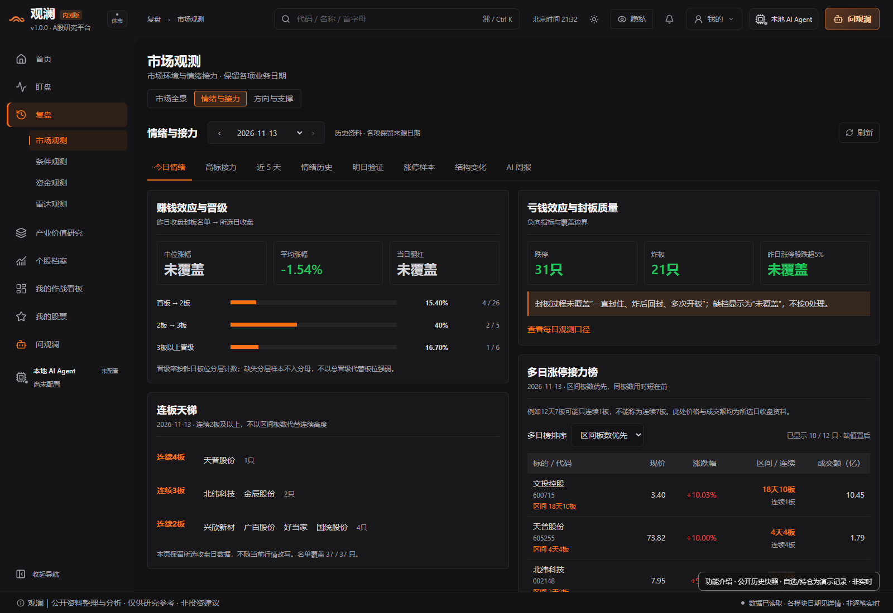
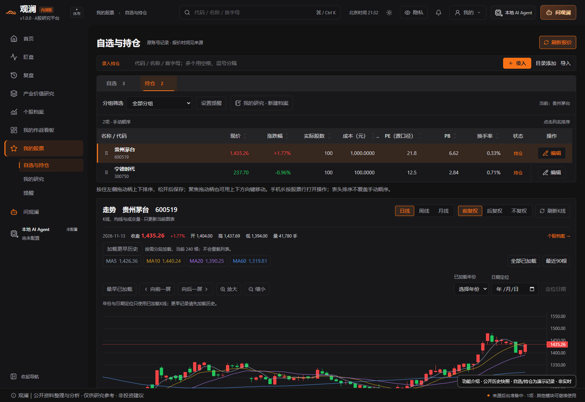
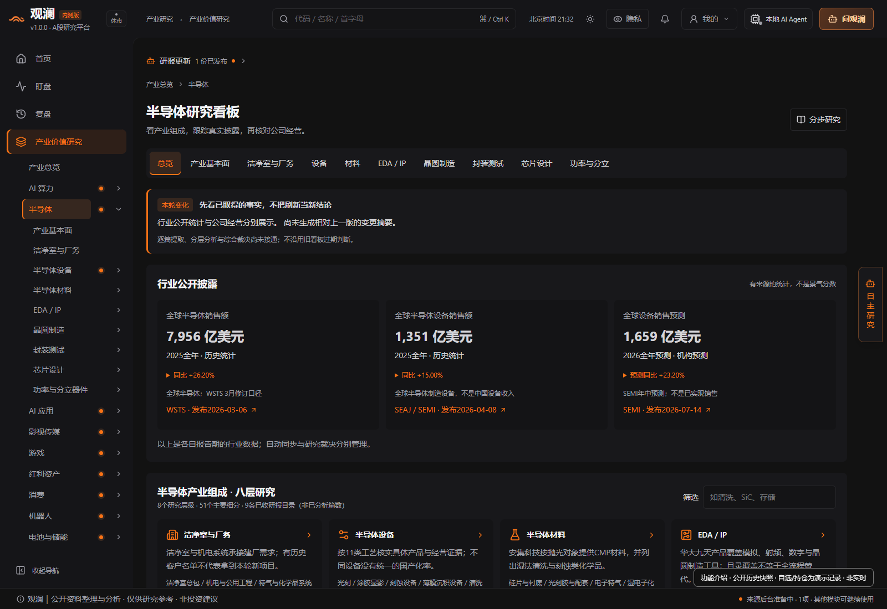
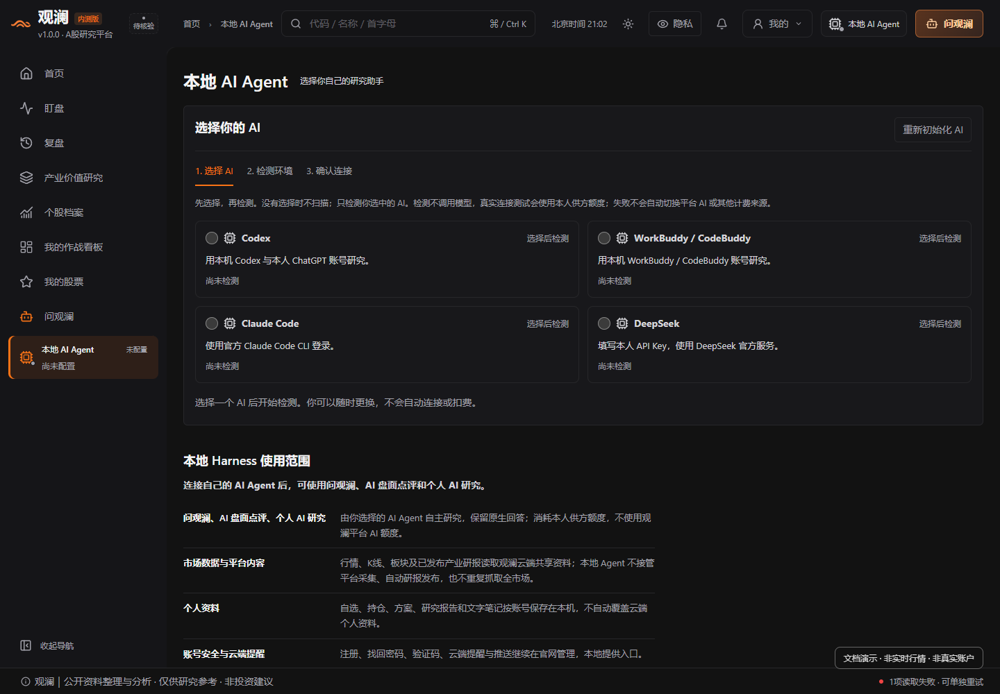
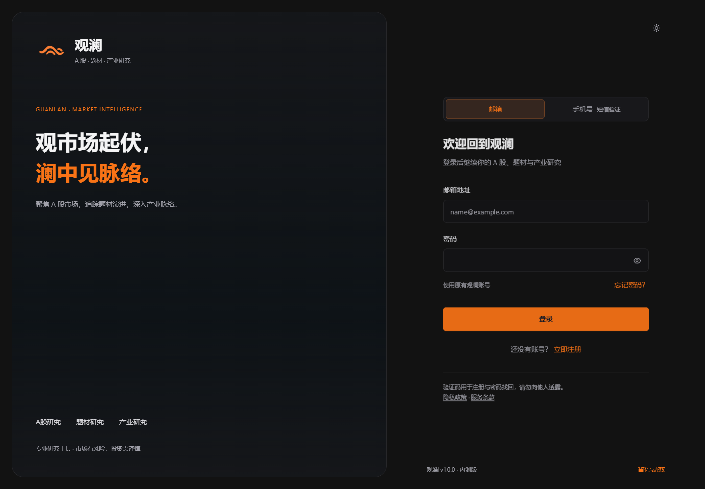

# 观澜 A 股研究工作台

**把看盘、复盘和研究串起来，用自己的 AI Agent 深入分析。**

观澜不只是把股票排成列表，而是把市场环境、短线情绪、题材梯队、个股异动、资金披露与产业证据放在同一套工作流里：先看市场，再找方向，最后把关注对象和自己的研究沉淀下来。

本仓库重点介绍 **Local Harness 本地版**：沿用观澜的界面和主要研究入口，连接自己的 Codex、WorkBuddy / CodeBuddy、Claude Code 或 DeepSeek，使用自己的供方账号与额度，保留原生研究过程的可见状态及最终回答。

> 配图说明：市场功能图使用已发布的公开历史快照，不是实时行情；自选、持仓与布局是隔离演示记录，不是任何人的真实资产。AI 回答图来自已保存的 Codex 官方文档验收，不是个股推荐。截图中的连接状态不代表你的设备已连接。

## 两个版本，怎样选择？

| | Local Harness 本地版 · 本仓库重点 | 在线版 · 试运营中 |
| --- | --- | --- |
| 适合谁 | 已使用自己的 AI Agent，希望在统一界面里看盘和研究的用户 | 希望直接用浏览器访问，不自行运行本地服务的用户 |
| 如何打开 | 在电脑启动本项目，访问本机地址 | [访问观澜在线版](https://guanlan-research.kunkun1023.xyz/next/) |
| AI 来源 | 自己配置的 Agent / API，使用自己的供方额度 | 观澜平台 AI，按在线账户权限与额度使用 |
| 市场与产业资料 | 用自己的观澜账号读取云端共享资料 | 由平台后台采集、更新和发布 |
| 个人记录 | 自选、持仓、方案和研究按账号保存在本机，不自动覆盖云端记录 | 云端个人资料，按在线账户管理 |
| 提醒与账号安全 | 提供官网管理入口，不承诺本地服务独立调度通知 | 官网负责规则、后台任务与通知，是否送达取决于规则和渠道状态 |
| 当前阶段 | **0.1.0-dev 私有开发预览**；Windows / Node.js 24 已验 | **试运营阶段**；功能、数据覆盖及服务策略仍在迭代 |

两个版本不是“两套互相同步的个人数据库”。本地 Agent 不接管平台采集、自动研报发布或云端提醒。共享资料范围以自己的观澜账号权限和实际数据覆盖为准。

本地 Harness 是在本机连接和调度 Agent，**不等于模型完全离线**：推理、API 和联网研究通常仍在所选供方的云端运行。移动布局适配也不等于手机可以直接调用电脑或安卓里的 WorkBuddy。

## 产品特点：怎样帮助用户看盘？

- **先看环境，再看个股。** 将指数、成交量能、涨跌分布、情绪与接力放在一起，帮助判断“今天是普涨、分化还是退潮”，减少只盯一只股票的视角偏差。
- **从单股跳动，看到题材的集体表现。** 结合细分行业、同向强股、成交活跃候选与异动窗口，观察是一只股票独自拉升，还是一组股票共同变化；不把概念关联直接当作主营受益证明。
- **筛选条件可以复用。** 平台预设负责快速切入，自定义条件和方案保留自己的观察口径；先缩小范围，再逐只核验证据，不把筛选命中当作买入信号。
- **资金的“今天”和“近几天”分开看。** 区分最近披露的单日机构净额与近5/10日窗口汇总，结合价格回撤观察资金足迹与分歧；披露记录不是机构实时持仓。
- **少跳页面，把注意力放在关注对象。** 自选、持仓、K线、个股/板块抽屉和自定义作战看板相互衔接，把常看的内容组织在同一处。
- **研究不只剩一段聊天。** 从产业环节、公司业务与公开证据进入自己的研究档案，保存文字笔记和AI报告，方便后续复核，而不是每次从头问。
- **原生 Agent，费用来源可见。** 本地版明确选择自己的 AI，不强制改成平台固定JSON；失败不自动换引擎或切平台扣费，浏览历史不重复调用模型。
- **承认数据边界。** 交易状态、业务日期、来源、采集时间与缺档分别展示。休市读历史快照，缺数据就保留缺口，不用“0”或模型猜测掩盖。

这些能力帮助组织观察、提出问题和验证判断，不替代交易纪律，也不保证收益。

## 六类核心功能

每个小节只介绍一个功能，图片紧跟对应说明。按“入口 → 图中看点 → 使用价值”阅读即可，不需要在前后文字中寻找配图。

### 1. 盯盘：短线情绪、题材梯队与异动

#### 1.1 热点题材：观察一个方向是否有集体支撑

**入口：** 盯盘 → 异动接力 → 热点题材。

每张题材卡片把细分行业、同向强股、成交活跃候选和支撑比例放在一起。可切换集体向上、集体向下或双向观察，再展开成员核对股票代码、现价、涨跌幅及梯队依据。

**图中看点：** 左侧是题材支撑卡片和“展开梯队”入口；右侧是保留日期、触发时间与依据的异动记录。上榜档案尚未准备好的项目会提示待准备，不补造连续活跃天数。

**使用价值：** 区分“只有一只股票动”与“一个方向共同变化”，不把单次拉升或概念关联直接当成产业受益证明。


#### 1.2 实时动态：把盘面读数和短线事件放在一起

**入口：** 盯盘 → 实时动态。

可在全市场、自选、持仓范围之间切换，结合指数、市场广度、盘中异动、昨日梯队及首板观察，查看与当前观察对象有关的变化。

**图中看点：** 顶部是市场读数，中部左侧是异动日期和事件类型，右侧是昨日梯队的观察范围；报价日期与采集时间单独展示。截图处于休市，未覆盖的当日事件和梯队保留缺口，不以旧记录冒充今日信号。

**使用价值：** 先看整体情绪，再核对事件是否有时间和范围上的支持。页面的“盯盘提示”提供提醒管理入口；本地版跳转官网管理，规则保存、提醒启用与通知送达是不同状态。


### 2. 复盘：市场、情绪、条件与资金分开看

#### 2.1 市场观测：先判断一天的市场环境

**入口：** 复盘 → 市场观测 → 市场全景。

把指数、涨跌分布、成交量能、风格、板块异动和风险偏好组织为同一套复盘入口，可按业务日期阅读已有资料。

**图中看点：** 上方是上涨/下跌、成交额、涨停/跌停与连板高度；下方是指数和同口径成交量能历史，口径差异会单独说明。

**使用价值：** 判断当天是普涨、分化还是整体走弱，避免仅凭自己的某只股票评价整个市场。


#### 2.2 情绪与接力：看晋级、亏钱效应和梯队结构

**入口：** 复盘 → 市场观测 → 情绪与接力。

观察赚钱效应、晋级、封板质量、连续板梯队和多日涨停接力；也可进入高标接力、题材轮动与已有情绪历史。

**图中看点：** 左上是分层晋级读数，右上是亏钱效应与覆盖提示，下面分别是连板天梯和多日涨停榜。“连续板”与“区间多次涨停”分开显示。

**使用价值：** 观察情绪扩散、分歧与修复，不把历史晋级率当作下一次交易的成功概率。



#### 2.3 条件观测：把自己的观察条件变成可复用筛选

**入口：** 复盘 → 条件观测 → 价量筛选。

使用主板、创业板、双创等平台预设，也可调整价量区间、封板状态、行业/概念并保存自己的方案。默认盘后，盘中共享快照需显式切换。

**图中看点：** 顶部是平台预设、数据口径与方案入口；下方是命中结果，代码、价格和涨跌幅优先展示，“符合条件”“缺数据”“不符合”单独计数。

**使用价值：** 先按一致口径缩小范围，再逐只核验；筛选命中不是买入建议，缺项不按零或不符合处理。


#### 2.4 资金足迹与分歧：区分最近一天与近几天的机构披露

**入口：** 复盘 → 条件观测 → 资金足迹与分歧。

交叉观察近5/10日机构买方出现、窗口机构净额、最近单日披露、高点回撤及价格变化，保留平台预设和自定义条件。

**图中看点：** 表头分别列出机构买方出现、近5日机构净额和最近机构披露；窗口日期及“单日榜汇总”角标说明累计口径，可排序、查看逐日依据。

**使用价值：** 找到“近期有机构披露、价格却在分歧”的研究对象。龙虎榜披露不是机构实时持仓；单日榜去重汇总与来源累计榜不混算，缺档时不冒充完整累计。


#### 2.5 资金观测：观察行业与概念的资金方向

**入口：** 复盘 → 资金观测。

切换行业/概念、净额/净占比及已有时间窗口，查看流入、流出与窗口变化，并进一步核对板块证据。

**图中看点：** 上方是分类、窗口与日期控件；下方分别排列净流入、净流出方向，保留来源、采集时间及覆盖说明。

**使用价值：** 观察资金方向是否与题材表现一致，不把行情供应方的资金读数等同于龙虎榜机构披露。雷达观测另提供实际覆盖的风险线索，不用这张资金图代替雷达结果。


### 3. 我的作战看板：组织自己的看盘屏幕

#### 3.1 自定义看板：把常看的组件放在同一处

**入口：** 我的作战看板。

添加市场概览、指数K线、观察池、持仓、个股/ETF报价、题材支撑、板块资金、相关事件或研究组件，按自己的习惯移动、调尺寸、隐藏或移除。

**图中看点：** 右上角是“布局与预设”“编辑布局”“添加组件”；下方是市场、观察池、持仓等独立组件，每个组件有自己的移动与设置入口。

**使用价值：** 减少为了核对几个关注对象而反复跳页。移除组件不删除自选或研究，添加组件不自动运行AI；布局按账号保存在当前浏览器，暂不跨设备同步。


### 4. 我的持仓和自选：从关注对象进入图表与研究

#### 4.1 自选列表：保留关注范围，快速查看价格与图表

**入口：** 我的股票 → 自选与持仓 → 自选。

按类型和分组查看关注对象，支持录入、排序和管理，选择一行后阅读对应K线，再进入个股资料或自己的研究档案。

**图中看点：** 上方是分组筛选，列表优先展示名称/代码、现价和涨跌幅；下方是所选对象的日/周/月K线、复权与均线入口。

**使用价值：** 将“我为什么关注它”和“它现在发生什么”衔接起来。手机端表格更紧凑，支持已实现的长按操作入口；字号适配不等于手机可运行桌面CLI。


#### 4.2 持仓记录：将已记录持仓与关注列表分开管理

**入口：** 我的股票 → 自选与持仓 → 持仓。

记录股数、成本与分组，结合已取得的报价阅读持仓对象，继续查看K线、资料或研究入口。

**图中看点：** “持仓”页签单独显示实际记录股数和成本；所选持仓仍可直接查看图表。图中股数、成本均为演示，不是真实资产。

**使用价值：** 区分“正在看”和“已经记录持有”。本地个人记录与云端独立保存；录入不代表券商成交同步，更不会执行交易。



### 5. 产业研究：从产业方向进入公司与证据

#### 5.1 产业总览：找到想研究的产业链

**入口：** 产业价值研究 → 产业总览。

浏览AI算力、半导体、AI应用、影视传媒、游戏、机器人、电池与储能、红利及消费等已开放方向，也可按产业、公司或代码检索。

**图中看点：** 每张产业卡片展示研究方向、主要环节、公司案例和进入研究入口；建设中目录与已开放方向分开标注。

**使用价值：** 从产业问题出发选择研究路径，而不是直接把热门概念当作公司结论。目录开放不代表全A股公司已研究完。


#### 5.2 产业链研究：沿环节理解公司，沿来源核验逻辑

**入口：** 产业价值研究 → 半导体；其他产业按各自结构组织。

按产业环节理解需求、产品、竞争位置与利润传导，再核对公司的具体业务、财务、公告和研报来源。

**图中看点：** 半导体页用上方页签组织洁净室、设备、材料、EDA/IP、制造、封测与设计；下方展示带日期和来源的行业披露，已发布研报更新有独立入口。

**使用价值：** 回答“公司处于哪一段、为什么可能受益、证据是什么”。概念关联、业务披露和已确认订单分别判断；资料覆盖与研究完成度分开说明，不把机构预测当作已实现业绩。



### 6. AI研判与分析：接入自己的Agent，保留自己的研究

#### 6.1 选择AI：只检测自己选中的引擎

**入口：** “问观澜”下方的本地 AI Agent，或右上角Agent状态灯。

选择Codex、WorkBuddy / CodeBuddy、Claude Code或DeepSeek，处理安装、登录或密钥要求后，主动测试并连接。

**图中看点：** 页面按“选择AI → 检测环境 → 确认连接”组织，候选卡片显示各自状态；没有选择时不自动扫描全部CLI。

**使用价值：** 清楚知道将使用哪个Agent及哪一方额度。环境检测不调用模型，主动连接测试会使用自己的供方额度；接入支持不等于每台设备都已验收可用。



#### 6.2 连接状态：随时确认当前使用哪个Agent

**入口：** 本地 AI Agent → 当前 AI Agent。

连接完成后显示已配置的引擎、连接状态与费用来源；需要变更时主动展开“更换 AI Agent”。

**图中看点：** 配置摘要、左侧菜单与右上角状态灯共同标明当前Agent，下面解释AI分析、共享数据、个人资料与云端提醒的职责边界。

**使用价值：** 不用每次猜测这轮由谁执行。连接状态不是每轮成功保证；失败不自动换供方或切平台扣费，原配置不会因为候选测试失败就被替换。


#### 6.3 问观澜：让自己的Agent原生研究和回答

**入口：** 问观澜。

明确提交问题后，由当前配置的Agent在已授权范围内自主组织研究，保留原生Markdown、表格和来源链接，不强制套平台JSON。

**图中看点：** 左侧是历史研究，中间是问题与原生回答，右侧保留已提供的研究依据；图中使用已完成的公开官方文档研究，不拿未经核验的股票结论做宣传。

**使用价值：** 从看盘时遇到的疑问继续深入研究。原生回答中的链接与推断仍需核验，不能仅因显示在页面里就视为平台已确认事实。浏览、刷新和重开已保存历史不重复调用模型；失败和中断保留原编号，不自动重跑。


复盘中的 **AI盘面点评** 同样使用自己配置的Agent，需要从点评入口明确发起；上图是问答示例，不是盘面点评生成结果。自动带入的是选定公开资料，不自动发送持仓成本。自己的网络、供方登录与额度影响实际可用性，本地Skill自动安装与平台专用编排完整迁移尚未宣称完成。

#### 6.4 个人研究档案：把一次分析变成可继续复核的记录

**入口：** 我的股票 → 我的研究 → 新建研究，或产业页的自主研究入口。

为公司、产业或专题确认研究对象、资料截止日期与研究重点，选择AI报告或文字笔记。可以研究平台名单以外的对象。

**图中看点：** 右侧抽屉明确展示当前Agent、研究类型、对象、产业、重点与资料日，再由用户确认是否开始研究。

**使用价值：** 保存自己的理由、证据、待核验项和报告历史，下次复核不必从头问。文字笔记不调用AI，平台资料更新也不自动改写个人结论。


## 一天怎么用观澜？

| 时点 | 建议查看 | 留下什么 |
| --- | --- | --- |
| 盘前 | 上一交易日市场观测、题材梯队、自己的观察池 | 今天重点核验的方向与条件 |
| 盘中 | 短线情绪、异动事件、板块同向支撑、作战看板 | 新变化及其来源时间，不把单次跳动直接当结论 |
| 收盘后 | 市场/情绪复盘、条件观测、资金足迹与分歧 | 更新后的观察名单及不成立的理由 |
| 深入研究 | 产业链、公司披露、自己的AI Agent与研究档案 | 业务逻辑、证据、待核验项和下一次复核条件 |

这是阅读与研究流程，不是自动交易策略。盘中数据以实际日期和采集时间为准，不保证逐笔实时；休市时可以继续阅读历史快照与研究资料。

## 安装前准备

- Windows；本轮实测 Node.js **24.15.0**。需要 Node.js **24或更高**、npm、Git与本私有仓库访问权限。
- 已有观澜账号；本地通过观澜邮箱与密码连接。注册、验证码、找回密码在官网完成。
- 至少一个AI来源：在自己的电脑上安装并登录Codex、WorkBuddy或Claude Code CLI，或准备自己的DeepSeek API Key。按供方官方文档完成安装登录，不向聊天或Git提供凭据。
- 其他系统和干净机器安装尚待完整验收。DeepSeek凭据库当前仅实现Windows用户级加密。

## 五分钟启动

在PowerShell执行：

```powershell
git clone https://github.com/joearkon/guanlan-a-stock-research.git
cd guanlan-a-stock-research
npm ci --prefix frontend
npm run build
npm start
```

打开 **http://127.0.0.1:38931/next/**。

构建自动准备OCR的Worker、语言包和许可证，不需要手工下载或提交生成文件。初次安装和构建需要网络。

### 登录共享数据账号

本地启动后，先在登录页连接自己的观澜账号；这个账号用于读取共享资料和隔离保存记录，与Agent供方登录相互独立。图中右侧填写邮箱和密码，账号安全管理仍在官网完成。



### 首次进入

1. 用观澜账号登录，连接共享数据；CLI登录与观澜登录是两个独立步骤。
2. 打开“问观澜”下方的“本地 AI Agent”，或右上角Agent状态灯。
3. 选择一个AI，只检测这一项；按提示处理安装、登录或密钥问题。
4. 核对费用来源，主动点击“测试并连接”。测试使用自己的供方额度，没有成功回执不显示已连接。
5. 连接后即可在问观澜、AI盘面点评、个人AI研究中明确发起分析。

没有选择时不自动扫描全部CLI。打开页面、环境检测、浏览历史或刷新状态都不调用模型。

配置示意见上文“6.1 选择AI”，连接状态示意见“6.2 连接状态”。

### 已配置后如何切换

配置页显示当前Agent、连接状态及费用来源。“更换 AI Agent”才展开候选；新候选失败不自动替换原配置，也不切其他引擎。

| 来源 | 配置 | 费用与验收边界 |
| --- | --- | --- |
| Codex | 使用自己的账号登录官方CLI | 自己的ChatGPT账号额度；已完成真实联网、保存、重开与防重复执行验收 |
| WorkBuddy / CodeBuddy | 使用自己的账号登录CLI，可指定安装位置 | 自己的供方额度；已有真实联网回执，本轮未新增付费重测 |
| Claude Code | 使用自己的账号登录官方CLI | 以检测到的订阅、Console/API等实际来源为准；接入与离线回归完成，需在自己的环境中主动实测 |
| DeepSeek | 在本地配置页填写API Key | 自己的API余额，含可能的联网费用；需自行配置后主动实测，不是网页聊天额度 |

DeepSeek Key使用Windows CurrentUser DPAPI加密保存，接口不回显、不上传SaaS；更换或移除后需重新测试。

## 典型使用流程

**问观澜：** 输入问题 → 按需选择研究设置 → 点击发送。手机回车换行；电脑Enter发送、Shift+Enter换行。问题模板只填草稿，不自动研究，也不表示本地Skill已安装或执行。原生回答不套固定JSON；右侧研究依据仅展示已提供的共享证据，不将模型链接自动认定为平台已核验事实。

**我的研究：** 在“我的股票 → 我的研究”创建公司、产业或专题，确认对象、日期和研究重点，选择AI报告或文字笔记。报告完成后留档、可重开历史；文字笔记不调用AI。

表单与功能说明见上文“6.4 个人研究档案”。

**盯盘与筛选：** 先看交易状态、数据日期和覆盖。休市可读上个已发布交易日快照，但不是当前盘中。条件观测默认盘后，可显式切盘中共享快照；筛选、排序、分页和保存不抓全市场、不调用模型。资金足迹近5/10日、单日榜和累计榜分别标注，缺档保留提示。

**产业研究：** 目录仅代表已覆盖范围，不承诺全A股公司研究完成。行业或概念关联不是业务受益证明，报告期不是当前行情日。平台资料可带入个人研究草稿，明确确认生成后才调用自己的Agent。

## 停止、更新与端口

- 停止：终端按Ctrl+C。进行中任务可能进入停止或待核对，不因重新启动自动调用模型。
- 再启动：仓库目录执行 `npm start`，已有构建可以直接用。
- 更新：先保留自己的修改并停止服务，再执行 `git pull --ff-only`、`npm ci --prefix frontend`、`npm run build`、`npm start`。
- 端口占用：当前PowerShell设置 `$env:GUANLAN_LOCAL_PORT="38932"` 后启动，改用相应端口；不会开放局域网。
- 重启后重新登录观澜：云端会话只存服务内存；Agent配置、个人记录和历史不因此清除。

同一数据目录不能同时启动两个服务；服务锁会阻止第二个实例。

## 数据、费用与安全

```text
.local/
├── research.sqlite   # 账号隔离资料、配置、任务、回执与研究历史
└── jobs/             # 本轮公开输入、证据等运行资料
```

- `.local`不进Git。备份前正常关闭服务，再备份整个目录；其中可能含个人研究与加密凭据，请妥善保管。
- 自选、持仓从本机独立记录开始，不自动同步或覆盖官网个人资料。
- 同一任务编号幂等；刷新、重开、核对已保存回执不新增执行。失败、超时或中断不自动重跑，不切平台扣费；先核对原任务。
- CLI启动次数不等于内部模型请求数。未提供的Token、剩余额度与金额不补零；失败或断网也可能有费用，以供方账单为准。
- 只自动提供明确提问与选定公开资料，不自动发送持仓成本、登录文件或密钥。自行写入提问的内容仍会交给供方，勿输入敏感信息。
- 本版本不开放交易、下单或任意本机文件读写。平台专用Skill编排未宣称完整迁移，本地Skill安装/调用尚待单独验收。

## 常见问题

**已经登录Codex，为何还要登录观澜？** 前者提供AI，后者提供共享数据和账号隔离，互不替代。

**已连接但研究失败？** 已连接表示有成功测试且当前环境就绪，不保证每轮网络、余额、供方服务或资料完整。保留原任务并核对，不要连点重新生成。

**没有市场数据怎么办？** 核对账号权限、网络与共享成品状态。页面保留原日期和缺口，不将旧数据改今日，不让AI补行情。

**手机能调用电脑或手机里的WorkBuddy吗？** 目前不提供跨设备连接；手机视口适配不等于已支持安卓/iOS远程调用或手机WorkBuddy接入。

**如何诊断环境？** 可主动运行 `npm run doctor` 只读扫描支持的CLI，不调用模型；这是手工诊断，与首次页面不自动扫描不同。不要在issue或日志中贴密钥、登录文件。

## 开发与验证

```powershell
npm test
npm --prefix frontend test
npm run build
```

真实供方验收是单独的付费操作，不应作为普通测试自动运行。详细范围见[QA.md](QA.md)，不能用夹具冒充自己的真实登录、全部数据、其他引擎或操作系统验收。

```text
frontend/   React界面与主题
src/        本地服务、研究任务、供方连接器、数据读取白名单
vendor/     保留许可的第三方CLI运行适配
shared/     产业目录与数据合同
web/        展示模型、品牌和题材资源
scripts/    构建准备、手工诊断与验收入口
test/       后端行为回归
docs/       使用说明配图
```

UI起始基线为已核验的SaaS `2026.11.13.7`；本地独立迭代，不自动随SaaS发布替换代码。见[溯源记录](baseline/production.json)。

## 许可与状态

本仓库目前私有，不因能访问代码而自动获得对完整SaaS衍生代码的开源或再分发许可。自有代码的公开范围与许可证待确认；第三方依赖保留各自许可，见[NOTICE.md](NOTICE.md)。

不要上传生产部署配置、数据库、CLI登录目录、原始日志或未脱敏截图。本文配图为用户要求整理的隔离介绍图，不含真实私人研究。

本工具用于公开资料整理与个人研究，不构成投资建议，不保证数据及时、完整或模型结论正确。
