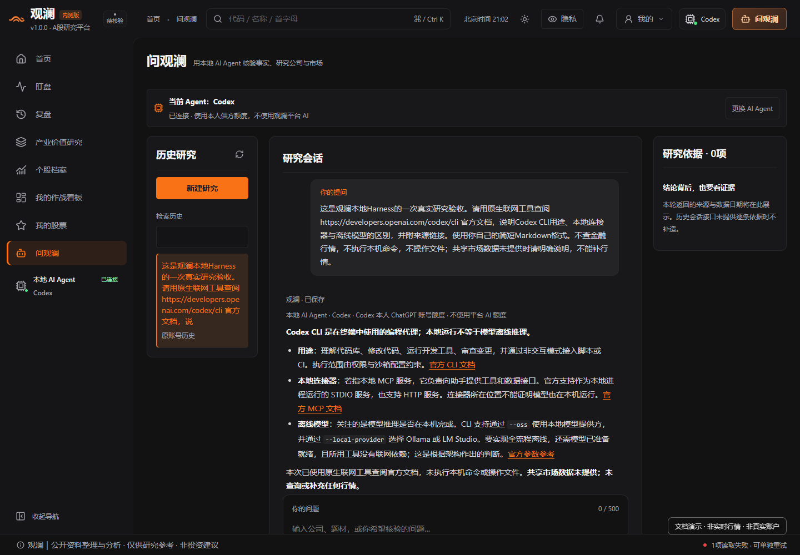
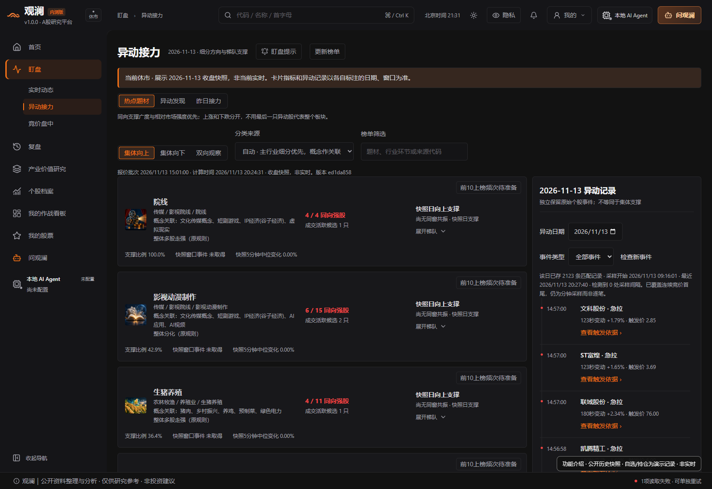
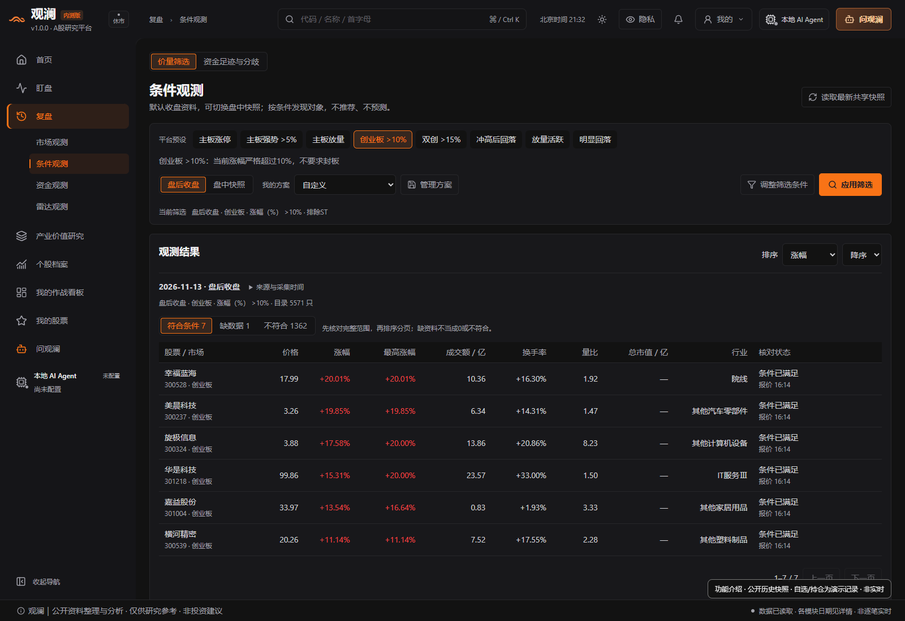
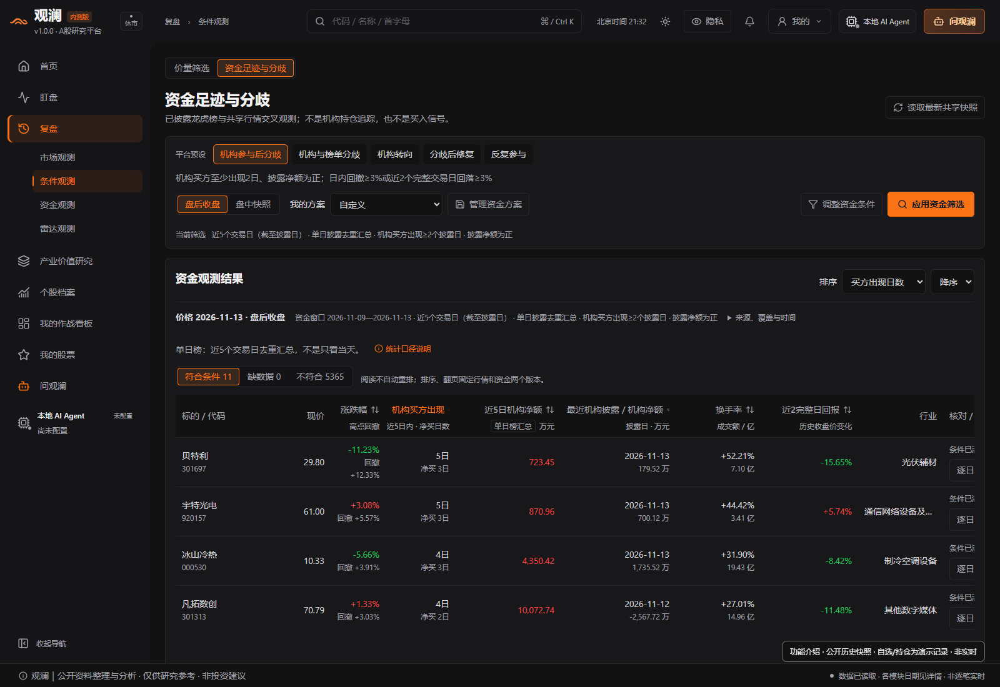
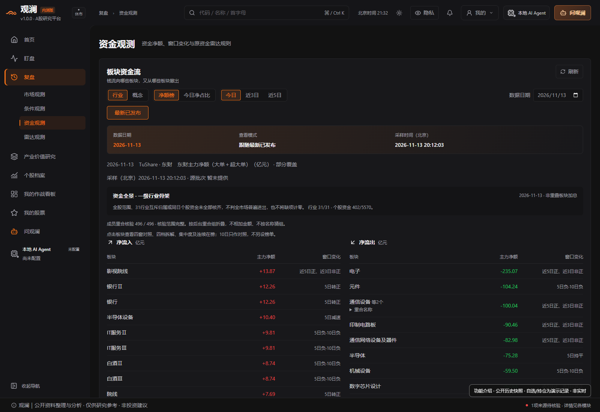
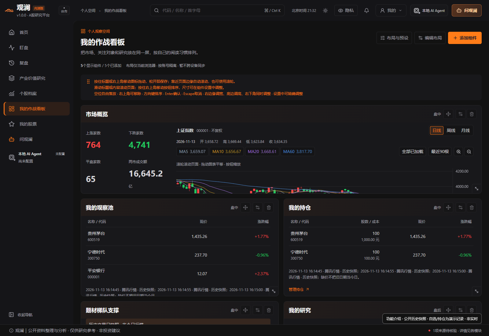

# 观澜 A 股研究工作台

**把看盘、复盘和研究串起来，用自己的 AI Agent 深入分析。**

观澜不只是把股票排成列表，而是把市场环境、短线情绪、题材梯队、个股异动、资金披露与产业证据放在同一套工作流里：先看市场，再找方向，最后把关注对象和自己的研究沉淀下来。

本仓库重点介绍 **Local Harness 本地版**：沿用观澜的界面和主要研究入口，连接自己的 Codex、WorkBuddy / CodeBuddy、Claude Code 或 DeepSeek，使用自己的供方账号与额度，保留原生研究过程的可见状态及最终回答。



> 配图说明：市场功能图使用已发布的公开历史快照，不是实时行情；自选、持仓与布局是隔离演示记录，不是任何人的真实资产。AI 回答图来自已保存的 Codex 官方文档验收，不是个股推荐。截图中的连接状态不代表你的设备已连接。

## 两个版本，怎样选择？

| | Local Harness 本地版 · 本仓库重点 | 在线版 · 试运营中 |
| --- | --- | --- |
| 适合谁 | 已使用自己的 AI Agent，希望在统一界面里看盘和研究的用户 | 希望直接用浏览器访问，不自行运行本地服务的用户 |
| 如何打开 | 在电脑启动本项目，访问本机地址 | [访问观澜在线版](https://guanlan-research.kunkun1023.xyz/next/) |
| AI 来源 | 自己配置的 Agent / API，使用自己的供方额度 | 观澜平台 AI，按在线账户权限与额度使用 |
| 市场与产业资料 | 用自己的观澜账号读取云端共享资料 | 由平台后台采集、更新和发布 |
| 个人记录 | 自选、持仓、方案和研究按账号保存在本机，不自动覆盖云端记录 | 云端个人资料，按在线账户管理 |
| 提醒与账号安全 | 提供官网管理入口，不承诺本地服务独立调度通知 | 官网负责规则、后台任务与通知，是否送达取决于规则和渠道状态 |
| 当前阶段 | **0.1.0-dev 私有开发预览**；Windows / Node.js 24 已验 | **试运营阶段**；功能、数据覆盖及服务策略仍在迭代 |

两个版本不是“两套互相同步的个人数据库”。本地 Agent 不接管平台采集、自动研报发布或云端提醒。共享资料范围以自己的观澜账号权限和实际数据覆盖为准。

本地 Harness 是在本机连接和调度 Agent，**不等于模型完全离线**：推理、API 和联网研究通常仍在所选供方的云端运行。移动布局适配也不等于手机可以直接调用电脑或安卓里的 WorkBuddy。

## 产品特点：怎样帮助用户看盘？

- **先看环境，再看个股。** 将指数、成交量能、涨跌分布、情绪与接力放在一起，帮助判断“今天是普涨、分化还是退潮”，减少只盯一只股票的视角偏差。
- **从单股跳动，看到题材的集体表现。** 结合细分行业、同向强股、成交活跃候选与异动窗口，观察是一只股票独自拉升，还是一组股票共同变化；不把概念关联直接当作主营受益证明。
- **筛选条件可以复用。** 平台预设负责快速切入，自定义条件和方案保留自己的观察口径；先缩小范围，再逐只核验证据，不把筛选命中当作买入信号。
- **资金的“今天”和“近几天”分开看。** 区分最近披露的单日机构净额与近5/10日窗口汇总，结合价格回撤观察资金足迹与分歧；披露记录不是机构实时持仓。
- **少跳页面，把注意力放在关注对象。** 自选、持仓、K线、个股/板块抽屉和自定义作战看板相互衔接，把常看的内容组织在同一处。
- **研究不只剩一段聊天。** 从产业环节、公司业务与公开证据进入自己的研究档案，保存文字笔记和AI报告，方便后续复核，而不是每次从头问。
- **原生 Agent，费用来源可见。** 本地版明确选择自己的 AI，不强制改成平台固定JSON；失败不自动换引擎或切平台扣费，浏览历史不重复调用模型。
- **承认数据边界。** 交易状态、业务日期、来源、采集时间与缺档分别展示。休市读历史快照，缺数据就保留缺口，不用“0”或模型猜测掩盖。

这些能力帮助组织观察、提出问题和验证判断，不替代交易纪律，也不保证收益。

## 六类核心功能

### 1. 盯盘：短线情绪、题材梯队与异动

每天打开盯盘，先了解涨跌环境与活跃方向，再看具体标的，不必在多个榜单之间来回拼线索。

- **实时动态：** 汇总已取得的盘面读数、涨停与接力信息、全日异动记录，区分事件时间与当前阅读时间。
- **题材与梯队：** 热点题材按来源分类展示同向强股、成交活跃候选、支撑比例与成员；展开可看股票代码、现价、涨跌幅和判断依据。
- **异动核对：** 查看触发时间、窗口变化与触发价，区分单股异动和板块共振。没有同窗证据时不强行判定“集体启动”。
- **昨日接力与持续观察：** 在已有档案覆盖下回看昨日基线、前排上榜与日期分布；上榜档案未准备好时明确提示，不补造连续活跃天数。
- **提醒与通知：** 从标的或板块入口管理关注与提醒。本地版跳转官网管理；规则保存、提醒启用和渠道送达是不同状态，并不是打开本地页面就自动订阅。

**帮助解决：** “今天市场在炒什么？是一只股票动，还是整个方向动？前排和成交核心分别是谁？”




### 2. 复盘：市场观测、条件观测与资金观测

把一天的变化拆成市场环境、情绪接力、方向支撑和资金披露，形成可重复的复盘顺序。

- **市场观测：** 指数、成交量能、涨跌分布、风格趋势、板块异动与风险偏好；保留业务日期，使用同口径历史观察量能。
- **情绪与接力：** 涨停/跌停、连板高度、高标接力、题材轮动及已有情绪历史，帮助观察分歧与修复，不编造未来成功率。
- **条件观测：** 主板、创业板、双创等平台预设，价量区间、封板状态、行业/概念及自定义方案；默认盘后，可显式切换盘中共享快照。
- **资金足迹与分歧：** 近5/10日机构买方出现、机构净额、最近单日披露、高点回撤等交叉观察。单日榜去重汇总与来源累计榜是不同口径，窗口不完整时不当作完整累计。
- **资金观测与雷达：** 按实际覆盖查看行业/概念资金方向、历史窗口与风险线索，再回到个股证据核验。行情资金读数与龙虎榜披露不混为同一类数据。
- **每日滚动：** 读取后台已发布的最新结果；晚到、缺档和过期状态保留原说明，不把旧日期改成今天。

**帮助解决：** “今天变强还是变弱？哪些对象符合自己的观察条件？近期有资金披露，但价格正在分歧的是哪些？”








### 3. 我的作战看板：把常看的内容放到同一屏

根据自己的看盘习惯组合组件，而不是接受固定的页面排列。

- 可添加市场概览、指数K线、A股指数、观察池、持仓、个股/ETF报价、题材梯队支撑、板块资金、相关事件与研究等组件。
- 支持移动、调整尺寸、隐藏、移除和布局预设；移除组件不删除自选或研究记录。
- 组件复用共享资料与已保存记录，添加面板不会自动生成AI报告。
- 布局按账号保存在当前浏览器，**暂不跨设备同步**；移动端保留阅读与明确的排序操作。

**帮助解决：** “我只关心几个指数、两条题材和自己的观察池，能不能放到一起看？”



### 4. 我的持仓和自选：从关注列表进入具体研究

把“正在关注”和“已经记录的持仓”分开管理，并保留进入图表、提醒与研究的入口。

- 自选与持仓分别查看，可分组、筛选、排序和录入；股票名称、代码、现价与涨跌幅优先展示。
- 查看日/周/月K线、复权方式、均线与成交量；缺少当期图表时允许单独重试，不拿其他周期冒充。
- 从个股或板块抽屉核对资料、所属行业/概念及实际已覆盖的相关信息。
- 研究入口可建立个人档案，记录自己的关注理由、验证条件与报告。
- 手机端表格更紧凑，支持已实现的长按操作入口；主题与字号设置服务于阅读，不承诺手机能运行桌面CLI。

本地个人记录与云端记录独立保存。持仓录入只是记录，不是券商成交同步，更不会执行交易。

**帮助解决：** “这只股票为什么在我的列表里？今天发生了什么？原来的观察理由还成立吗？”


### 5. 产业研究：沿产业链理解公司，沿证据验证受益逻辑

从产业总览进入环节，再深入公司，而不是把“属于某题材”当作研究结论。

- 已开放AI算力、半导体、AI应用、影视传媒、游戏、机器人、电池与储能，以及红利、消费等方向；煤炭、油气等建设中目录单独标注。
- 按产业环节理解需求、产品、竞争位置与利润传导，进一步核对公司的具体业务和公开披露。
- 展示已覆盖的财务、公告或研报来源、数据日期和版本说明；平台发布的研究更新可点击查看摘要。
- 区分“概念关联”“公司披露的业务”“已确认的订单/客户”，不把所有营收都算作某项热门业务。
- 没找到公司或想研究其他环节，可以创建自己的公司、产业或专题研究，不限于平台案例。

不是全A股公司已研究完，也不是财报与产业资料全部自动实时更新；已开放目录、真实数据覆盖和研究完成度分别说明。

**帮助解决：** “这家公司究竟做产业链的哪一段？为什么可能受益？有哪些原始资料支持，哪些还只是推断？”


### 6. AI研判与分析：用自己的 Agent，把问题继续研究下去

本地版的重点，不只是更换模型名称，而是把自己的 Agent 接入现有看盘与研究场景。

- **问观澜：** 自由提问、研究公司或题材，按已授权范围由所选Agent原生联网研究，保留原生Markdown、表格与来源链接。
- **AI盘面点评：** 从复盘入口明确发起，使用自己配置的同一Agent分析已提供的盘面资料；不自动切平台模型。
- **个人AI研究：** 为公司、产业或专题确认对象、资料截止日期和重点，生成后保留报告历史；也可只写文字笔记。
- **配置与状态：** 选择Agent → 只检测所选项 → 主动测试并连接；左侧入口、顶部状态灯和研究页面提示当前配置，可主动更换。
- **费用与失败：** 使用自己的供方额度；重复刷新或重开已保存任务不重新执行，失败和中断保留原编号，不自动换供方或重跑。
- **证据边界：** 自动带入选定的公开共享资料，不自动发送持仓成本。模型给出的链接或判断仍需要核验，不能因显示在回答里就视为平台已确认事实。

支持Codex、WorkBuddy / CodeBuddy、Claude Code与DeepSeek接入；实际可用取决于自己的安装、登录、密钥、网络与供方服务。各引擎验收范围见下方说明。本地Skill自动安装和平台专用编排的完整迁移尚未宣称完成。


原生回答示例见本文开头的问观澜截图。为避免拿未经核验的股票结论做宣传，配图使用已完成的公开官方文档研究。

## 一天怎么用观澜？

| 时点 | 建议查看 | 留下什么 |
| --- | --- | --- |
| 盘前 | 上一交易日市场观测、题材梯队、自己的观察池 | 今天重点核验的方向与条件 |
| 盘中 | 短线情绪、异动事件、板块同向支撑、作战看板 | 新变化及其来源时间，不把单次跳动直接当结论 |
| 收盘后 | 市场/情绪复盘、条件观测、资金足迹与分歧 | 更新后的观察名单及不成立的理由 |
| 深入研究 | 产业链、公司披露、自己的AI Agent与研究档案 | 业务逻辑、证据、待核验项和下一次复核条件 |

这是阅读与研究流程，不是自动交易策略。盘中数据以实际日期和采集时间为准，不保证逐笔实时；休市时可以继续阅读历史快照与研究资料。

## 安装前准备

- Windows；本轮实测 Node.js **24.15.0**。需要 Node.js **24或更高**、npm、Git与本私有仓库访问权限。
- 已有观澜账号；本地通过观澜邮箱与密码连接。注册、验证码、找回密码在官网完成。
- 至少一个AI来源：在自己的电脑上安装并登录Codex、WorkBuddy或Claude Code CLI，或准备自己的DeepSeek API Key。按供方官方文档完成安装登录，不向聊天或Git提供凭据。
- 其他系统和干净机器安装尚待完整验收。DeepSeek凭据库当前仅实现Windows用户级加密。

## 五分钟启动

在PowerShell执行：

```powershell
git clone https://github.com/joearkon/guanlan-a-stock-research.git
cd guanlan-a-stock-research
npm ci --prefix frontend
npm run build
npm start
```

打开 **http://127.0.0.1:38931/next/**。

构建自动准备OCR的Worker、语言包和许可证，不需要手工下载或提交生成文件。初次安装和构建需要网络。


### 首次进入

1. 用观澜账号登录，连接共享数据；CLI登录与观澜登录是两个独立步骤。
2. 打开“问观澜”下方的“本地 AI Agent”，或右上角Agent状态灯。
3. 选择一个AI，只检测这一项；按提示处理安装、登录或密钥问题。
4. 核对费用来源，主动点击“测试并连接”。测试使用自己的供方额度，没有成功回执不显示已连接。
5. 连接后即可在问观澜、AI盘面点评、个人AI研究中明确发起分析。

没有选择时不自动扫描全部CLI。打开页面、环境检测、浏览历史或刷新状态都不调用模型。


### 已配置后如何切换

配置页显示当前Agent、连接状态及费用来源。“更换 AI Agent”才展开候选；新候选失败不自动替换原配置，也不切其他引擎。


| 来源 | 配置 | 费用与验收边界 |
| --- | --- | --- |
| Codex | 使用自己的账号登录官方CLI | 自己的ChatGPT账号额度；已完成真实联网、保存、重开与防重复执行验收 |
| WorkBuddy / CodeBuddy | 使用自己的账号登录CLI，可指定安装位置 | 自己的供方额度；已有真实联网回执，本轮未新增付费重测 |
| Claude Code | 使用自己的账号登录官方CLI | 以检测到的订阅、Console/API等实际来源为准；接入与离线回归完成，需在自己的环境中主动实测 |
| DeepSeek | 在本地配置页填写API Key | 自己的API余额，含可能的联网费用；需自行配置后主动实测，不是网页聊天额度 |

DeepSeek Key使用Windows CurrentUser DPAPI加密保存，接口不回显、不上传SaaS；更换或移除后需重新测试。

## 典型使用流程

**问观澜：** 输入问题 → 按需选择研究设置 → 点击发送。手机回车换行；电脑Enter发送、Shift+Enter换行。问题模板只填草稿，不自动研究，也不表示本地Skill已安装或执行。原生回答不套固定JSON；右侧研究依据仅展示已提供的共享证据，不将模型链接自动认定为平台已核验事实。

**我的研究：** 在“我的股票 → 我的研究”创建公司、产业或专题，确认对象、日期和研究重点，选择AI报告或文字笔记。报告完成后留档、可重开历史；文字笔记不调用AI。


**盯盘与筛选：** 先看交易状态、数据日期和覆盖。休市可读上个已发布交易日快照，但不是当前盘中。条件观测默认盘后，可显式切盘中共享快照；筛选、排序、分页和保存不抓全市场、不调用模型。资金足迹近5/10日、单日榜和累计榜分别标注，缺档保留提示。

**产业研究：** 目录仅代表已覆盖范围，不承诺全A股公司研究完成。行业或概念关联不是业务受益证明，报告期不是当前行情日。平台资料可带入个人研究草稿，明确确认生成后才调用自己的Agent。

## 停止、更新与端口

- 停止：终端按Ctrl+C。进行中任务可能进入停止或待核对，不因重新启动自动调用模型。
- 再启动：仓库目录执行 `npm start`，已有构建可以直接用。
- 更新：先保留自己的修改并停止服务，再执行 `git pull --ff-only`、`npm ci --prefix frontend`、`npm run build`、`npm start`。
- 端口占用：当前PowerShell设置 `$env:GUANLAN_LOCAL_PORT="38932"` 后启动，改用相应端口；不会开放局域网。
- 重启后重新登录观澜：云端会话只存服务内存；Agent配置、个人记录和历史不因此清除。

同一数据目录不能同时启动两个服务；服务锁会阻止第二个实例。

## 数据、费用与安全

```text
.local/
├── research.sqlite   # 账号隔离资料、配置、任务、回执与研究历史
└── jobs/             # 本轮公开输入、证据等运行资料
```

- `.local`不进Git。备份前正常关闭服务，再备份整个目录；其中可能含个人研究与加密凭据，请妥善保管。
- 自选、持仓从本机独立记录开始，不自动同步或覆盖官网个人资料。
- 同一任务编号幂等；刷新、重开、核对已保存回执不新增执行。失败、超时或中断不自动重跑，不切平台扣费；先核对原任务。
- CLI启动次数不等于内部模型请求数。未提供的Token、剩余额度与金额不补零；失败或断网也可能有费用，以供方账单为准。
- 只自动提供明确提问与选定公开资料，不自动发送持仓成本、登录文件或密钥。自行写入提问的内容仍会交给供方，勿输入敏感信息。
- 本版本不开放交易、下单或任意本机文件读写。平台专用Skill编排未宣称完整迁移，本地Skill安装/调用尚待单独验收。

## 常见问题

**已经登录Codex，为何还要登录观澜？** 前者提供AI，后者提供共享数据和账号隔离，互不替代。

**已连接但研究失败？** 已连接表示有成功测试且当前环境就绪，不保证每轮网络、余额、供方服务或资料完整。保留原任务并核对，不要连点重新生成。

**没有市场数据怎么办？** 核对账号权限、网络与共享成品状态。页面保留原日期和缺口，不将旧数据改今日，不让AI补行情。

**手机能调用电脑或手机里的WorkBuddy吗？** 目前不提供跨设备连接；手机视口适配不等于已支持安卓/iOS远程调用或手机WorkBuddy接入。

**如何诊断环境？** 可主动运行 `npm run doctor` 只读扫描支持的CLI，不调用模型；这是手工诊断，与首次页面不自动扫描不同。不要在issue或日志中贴密钥、登录文件。

## 开发与验证

```powershell
npm test
npm --prefix frontend test
npm run build
```

真实供方验收是单独的付费操作，不应作为普通测试自动运行。详细范围见[QA.md](QA.md)，不能用夹具冒充自己的真实登录、全部数据、其他引擎或操作系统验收。

```text
frontend/   React界面与主题
src/        本地服务、研究任务、供方连接器、数据读取白名单
vendor/     保留许可的第三方CLI运行适配
shared/     产业目录与数据合同
web/        展示模型、品牌和题材资源
scripts/    构建准备、手工诊断与验收入口
test/       后端行为回归
docs/       使用说明配图
```

UI起始基线为已核验的SaaS `2026.11.13.7`；本地独立迭代，不自动随SaaS发布替换代码。见[溯源记录](baseline/production.json)。

## 许可与状态

本仓库目前私有，不因能访问代码而自动获得对完整SaaS衍生代码的开源或再分发许可。自有代码的公开范围与许可证待确认；第三方依赖保留各自许可，见[NOTICE.md](NOTICE.md)。

不要上传生产部署配置、数据库、CLI登录目录、原始日志或未脱敏截图。本文配图为用户要求整理的隔离介绍图，不含真实私人研究。

本工具用于公开资料整理与个人研究，不构成投资建议，不保证数据及时、完整或模型结论正确。
