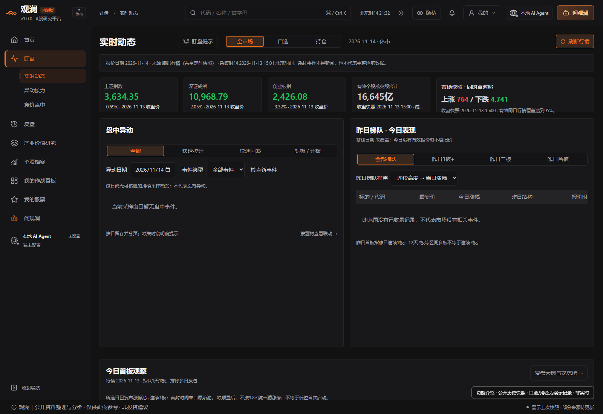
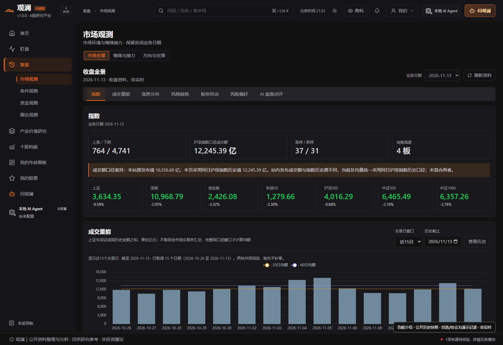
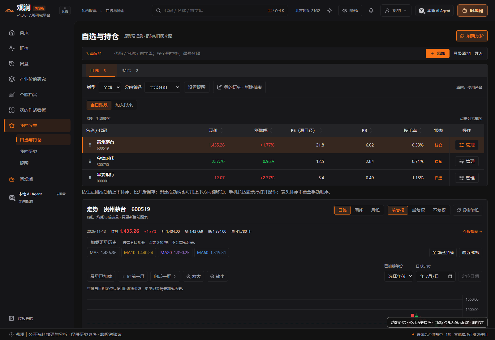
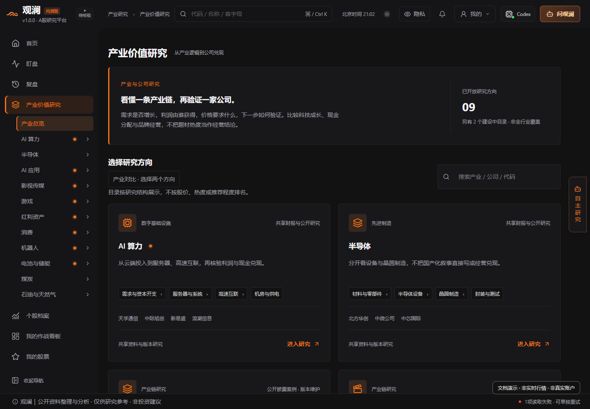
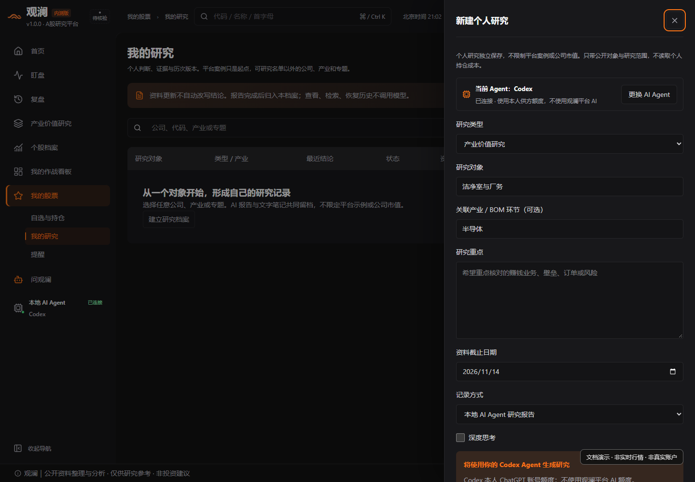

# 观澜 · A 股研究工作台

**用自己的 AI Agent，把看盘、复盘和产业研究串起来。**

观澜将市场情绪、题材梯队、个股异动、资金披露与公司证据放在同一个工作台。适合每天看盘、收盘复盘，并希望把关注理由持续记录下来的用户。

本仓库是 **Local Harness 本地版**：界面在自己的电脑运行，市场资料连接观澜共享数据，AI 分析使用自己配置的 Codex、WorkBuddy / CodeBuddy、Claude Code 或 DeepSeek。

[快速开始](#快速开始) · [功能介绍](#功能介绍) · [详细使用指南](docs/USAGE.md) · [在线版（试运营）](https://guanlan-research.kunkun1023.xyz/next/)

## 快速开始

准备 Windows、Node.js 24+、Git、观澜账号，以及自己的 AI Agent 或 DeepSeek API Key。当前仓库为私有开发预览，克隆需要仓库访问权限。

```powershell
git clone https://github.com/joearkon/guanlan-a-stock-research.git
cd guanlan-a-stock-research
npm ci --prefix frontend
npm run build
npm start
```

打开 **http://127.0.0.1:38931/next/**，完成三步：

1. **登录观澜**，连接共享市场资料。
2. **连接自己的 AI**：打开左侧“本地 AI Agent” → 选择引擎 → 检测 → 测试并连接。
3. **开始使用**：盯盘看变化，复盘找对象；需要深入时，在“问观澜”或“我的研究”发起分析。

环境检测不调用模型；主动连接测试和AI研究使用自己的供方额度。CLI需先安装登录，DeepSeek密钥只在本地配置页填写。[安装、配置与排错 →](docs/USAGE.md)

## 选择哪个版本？

| | 本地 Harness · 本仓库 | 在线版 · 试运营 |
| --- | --- | --- |
| 使用方式 | 在自己的电脑启动 | 浏览器直接访问 |
| AI分析 | 自己的Agent与供方额度 | 观澜平台AI与账户额度 |
| 个人记录 | 按账号保存在本机 | 保存在云端 |

两个版本读取观澜共享市场资料，但个人记录不自动互相覆盖。本地版的账号安全、提醒与通知在官网管理；“本地”指连接与调度在本机，不代表模型完全离线。

## 为什么用观澜？

- **把零散线索接起来：** 从大盘环境到题材、个股和资金，再进入证据与研究，不只看一张涨幅榜。
- **保留自己的观察方式：** 自定义筛选、关注分组与作战看板，减少重复切页和从头整理。
- **让研究可以继续：** 使用自己的Agent原生回答，保存笔记与报告；日期、来源和缺档保留，便于下次核验。

## 功能介绍

> 下图市场资料为公开历史快照，非实时行情；自选与持仓为演示记录，非真实资产。AI回答配图使用已保存的官方文档研究。

### 盯盘 · 看情绪、找题材、核对异动

在 **盯盘 → 异动接力**，把同向强股、成交活跃候选和支撑比例放在一起观察。展开梯队查看成员，结合右侧事件时间判断是一只股票跳动，还是一个方向共同变化。


<details>
<summary>查看实时动态：市场读数、盘中事件与昨日梯队</summary>

在 **盯盘 → 实时动态** 切换全市场、自选或持仓，查看指数、市场广度、异动类型与昨日梯队。截图处于休市，未覆盖的当日事件明确留空。



“盯盘提示”及标的/板块提醒入口可前往官网管理通知；保存规则不等于已启用或已送达。

</details>

### 复盘 · 先看市场，再筛选值得研究的对象

在 **复盘 → 市场观测**，一起看指数、涨跌广度、成交量能与风险偏好，先判断市场环境，再评价个股表现。图中的历史量能保留日期和统计口径。



<details>
<summary>展开情绪接力、条件筛选与两类资金观察</summary>

**情绪与接力：** 看分层晋级、亏钱效应、连板梯队和多日涨停，观察分歧与修复；连续板与区间多次涨停分开统计。


**条件观测：** 使用平台预设，或调整价量、封板、行业/概念并保存自己的方案。默认盘后，可显式切盘中共享快照；命中、缺数据与不符合分列。


**资金足迹与分歧：** 结合近5/10日机构买方出现、窗口净额和价格回撤找研究对象。最近单日披露与窗口汇总分别显示，可排序并查看逐日依据。


**资金观测：** 切换行业/概念和时间窗口，看净流入、净流出与方向变化。这里的行情资金读数与龙虎榜机构披露是不同口径。


龙虎榜不是机构实时持仓，历史晋级率不是未来胜率，筛选命中也不是买入信号；窗口缺档不补成完整累计。

</details>

### 我的作战看板 · 把常看的内容放在同一屏

添加市场、指数K线、观察池、持仓、题材、资金或研究组件，拖动排列、调整尺寸，形成自己的看盘屏幕。右上角可添加组件或切换布局；移除组件不删除原始记录。


布局按账号保存在当前浏览器，暂不跨设备同步；添加组件不会自动运行AI。

### 自选与持仓 · 从关注列表直接进入图表和研究

在 **我的股票 → 自选与持仓** 管理分组、排序和关注对象。选择股票后直接看日/周/月K线、复权与均线，再进入个股资料或建立自己的研究档案。



<details>
<summary>查看持仓记录：股数、成本与对应图表</summary>

持仓页签将已记录持有的对象与普通自选分开，保留股数、成本、分组及图表入口。图中为演示记录，不是券商资产同步。


手机端提供紧凑表格和已实现的长按操作入口；录入只是记录，不执行交易。

</details>

### 产业研究 · 沿产业链理解公司，沿来源验证逻辑

从 **产业价值研究** 进入AI算力、半导体、AI应用、影视传媒、机器人等方向，再沿环节深入公司业务。产业卡片展示主要环节和案例，建设中目录单独标注。



<details>
<summary>查看半导体研究：产业环节与公开证据</summary>

通过环节页签查看洁净室、设备、材料、EDA/IP、制造、封测与设计等内容，结合带来源、日期的披露核对受益逻辑。研报更新有独立摘要入口。


概念关联不等于已确认订单，机构预测不等于已实现业绩；目录开放也不代表全A股公司已完成研究。平台未覆盖的对象可创建自己的研究。

</details>

### AI研判 · 使用自己的Agent，留下自己的研究

**连接自己的AI。** 在“本地 AI Agent”选择引擎，只检测选中的一项，测试成功后保存。左侧菜单和顶部状态灯显示当前配置，之后可主动更换。


**在问观澜继续研究。** 明确提交问题后，由当前Agent自主组织研究，保留原生Markdown、表格和来源链接；历史会话可以继续阅读。


<details>
<summary>查看连接状态与个人研究档案</summary>

**确认当前Agent。** 配置摘要显示引擎、连接状态与费用来源；更换候选失败不会自动替换原配置。


**建立自己的研究档案。** 为公司、产业或专题确认对象、重点与资料日，选择AI报告或文字笔记，保存后续复核记录，不限平台案例。



</details>

复盘中的 **AI盘面点评** 也使用同一配置，需要主动发起。刷新和重开已保存历史不重复调用模型，失败不自动重跑或切平台扣费。模型结论和链接仍需核验；不自动发送持仓成本。本地Skill自动安装与平台编排完整迁移尚未宣称完成。

## 从每天的观察开始

**盘前**看上一交易日与观察池 → **盘中**看情绪、异动和看板 → **收盘后**做市场与资金复盘 → **需要深入时**进入产业、AI与自己的研究档案。

先记录“为什么关注、依据是什么、下一次核验什么”，再持续更新，而不是每次从零开始。

## 后续计划 · 让工作台更懂自己的打法

从通用看盘工具，逐步走向“自己的知识、自己的战法、自己的观察流程”。以下为规划方向，尚未作为当前功能交付，也不承诺上线日期。

- **自己的知识库：** 整理研究笔记、学习资料、历史案例和经验，保留来源与版本，供自己检索和AI按授权引用。
- **自己的战法库：** 记录适用的市场环境、选股条件、排除项、风险约束和失效条件。AI协助把文字经验拆成可核验规则，由自己确认，不擅自改写打法。
- **按战法筛选标的：** 将已确认规则与行情、题材、资金等共享资料结合，解释哪些条件满足、哪些不满足、哪些缺数据；需要主观判断的部分单列，不伪装成确定信号。
- **AI协助持续复盘：** 围绕候选对象补充证据、检查反例，保存当时的规则与判断，后续核对哪些条件兑现、哪些失效，让经验可以积累，而不是只留下聊天。

优先从知识与战法记录做起，再接规则筛选和复盘反馈。个人知识默认本地保存，交给Agent的资料由自己选择；战法匹配用于辅助观察，不承诺收益、不自动下单。

## 使用与项目说明

- [安装、Agent配置、更新与常见问题](docs/USAGE.md)
- [验收范围与已知边界](QA.md)
- [许可与第三方说明](NOTICE.md) · [初始线上基线](baseline/production.json)

当前为 **0.1.0-dev 私有开发预览**，尚不代表全部SaaS功能、其他系统、干净机器或真实手机跨设备均已验收。公开范围与许可证待确认，本仓库暂未公开开源。

行情以实际资料日期和采集时间为准，不保证逐笔实时；缺数据保留缺口。本工具用于公开资料整理与个人研究，不执行交易，不构成投资建议或收益承诺。
