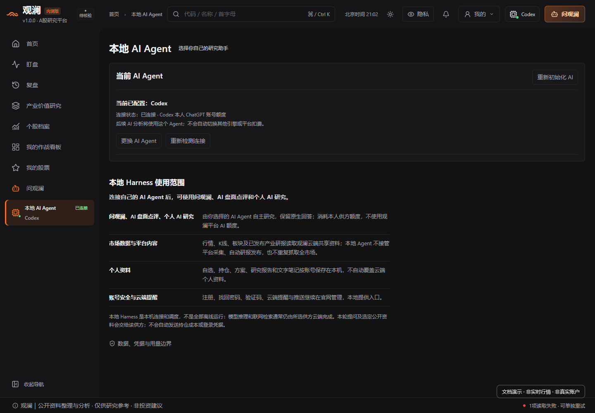

# 观澜 A 股研究工作台

**Local Harness · 在观澜界面里，使用你自己的 AI Agent。**

本地运行研究工作台，用本人观澜账号读取云端共享资料，再交给自己选择的 Codex、WorkBuddy / CodeBuddy、Claude Code 或 DeepSeek 分析。保留原生回答，个人研究按账号保存在本机。

当前为 **0.1.0-dev 私有开发预览**。Windows / Node.js 24 已验；不是离线行情终端，不提供交易或下单功能，也不代表所有 SaaS 功能已完成本地等价验收。


> 配图来自隔离演示或验收环境，不展示真实持仓、邮箱、密钥或账号额度。研究图使用已保存的 Codex 官方文档验收回答，不是证券推荐；图中状态不代表你的设备已连接。

## 功能板块

| 板块 | 用途 |
| --- | --- |
| 首页 · 今日研究台 | 共享市场资料、指数、板块与研究入口，保留来源及日期 |
| 盯盘 | 实时动态、异动接力、竞价观察；休市明确标注快照，不冒充今日实时 |
| 复盘 | 市场观测、情绪与接力、资金观测、雷达观测 |
| 条件观测 | 价量预设、自定义条件、资金足迹与分歧；单日与累计分开，缺数据不补造 |
| 产业价值研究 | 半导体、AI算力、AI应用、影视、机器人等已开放资料；建设中目录不算研究完成 |
| 个股档案 | K线、行情、财务、公告及板块关联，按来源实际覆盖展示 |
| 我的股票 | 本机自选、持仓与方案；录入不代表执行交易 |
| 我的研究 | 公司、产业、专题研究，报告历史与文字笔记 |
| 我的作战看板 | 组合观察组件，保存当前浏览器的布局 |
| 问观澜 | 明确提问后由当前Agent研究，展示原生Markdown、表格和来源链接 |


## 本地版与 SaaS 的区别

| 内容 | 本地 Harness | 观澜 SaaS |
| --- | --- | --- |
| 主动AI分析 | 本人的Agent、API与供方额度 | 平台模型与额度 |
| 行情、板块、已发布研报 | 本人账号只读共享资料 | 后台采集、自动更新与发布 |
| 自选、持仓、方案、研究 | 按账号独立保存在本机 | 云端个人资料 |
| 账号安全、提醒、推送 | 提供官网管理入口 | 官网继续管理 |
| 访问 | 默认仅127.0.0.1 | 云端站点 |

本地Agent不接管平台采集、自动研报或提醒调度，不自动复制或覆盖官网个人资料。共享资料范围取决于本人观澜账号权限。

本地Harness指连接与调度在本机；**模型推理和检索通常仍在供方云端完成，不是全部离线。**

## 安装前准备

- Windows；本轮实测 Node.js **24.15.0**。需要 Node.js **24或更高**、npm、Git与本私有仓库访问权限。
- 已有观澜账号；本地通过观澜邮箱与密码连接。注册、验证码、找回密码在官网完成。
- 至少一个AI来源：本人已安装并登录的Codex、WorkBuddy或Claude Code CLI，或本人DeepSeek API Key。按供方官方文档完成安装登录，不向聊天或Git提供凭据。
- 其他系统和干净机器安装尚待完整验收。DeepSeek凭据库当前仅实现Windows用户级加密。

## 五分钟启动

在PowerShell执行：

```powershell
git clone https://github.com/joearkon/guanlan-a-stock-research.git
cd guanlan-a-stock-research
npm ci --prefix frontend
npm run build
npm start
```

打开 **http://127.0.0.1:38931/next/**。

构建自动准备OCR的Worker、语言包和许可证，不需要手工下载或提交生成文件。初次安装和构建需要网络。


### 首次进入

1. 用观澜账号登录，连接共享数据；CLI登录与观澜登录是两个独立步骤。
2. 打开“问观澜”下方的“本地 AI Agent”，或右上角Agent状态灯。
3. 选择一个AI，只检测这一项；按提示处理安装、登录或密钥问题。
4. 核对费用来源，主动点击“测试并连接”。测试使用本人供方额度，没有成功回执不显示已连接。
5. 连接后即可在问观澜、AI盘面点评、个人AI研究中明确发起分析。

没有选择时不自动扫描全部CLI。打开页面、环境检测、浏览历史或刷新状态都不调用模型。


### 已配置后如何切换

配置页显示当前Agent、连接状态及费用来源。“更换 AI Agent”才展开候选；新候选失败不自动替换原配置，也不切其他引擎。



| 来源 | 配置 | 费用与验收边界 |
| --- | --- | --- |
| Codex | 本人官方CLI登录 | 本人ChatGPT账号额度；已完成真实联网、保存、重开与防重复执行验收 |
| WorkBuddy / CodeBuddy | 本人CLI登录，可指定安装位置 | 本人供方额度；已有真实联网回执，本轮未新增付费重测 |
| Claude Code | 本人官方CLI登录 | 以检测到的订阅、Console/API等实际来源为准；接入与离线回归完成，本人环境需主动实测 |
| DeepSeek | 在本地配置页填写API Key | 本人API余额，含可能的联网费用；需本人配置后主动实测，不是网页聊天额度 |

DeepSeek Key使用Windows CurrentUser DPAPI加密保存，接口不回显、不上传SaaS；更换或移除后需重新测试。

## 典型使用流程

**问观澜：** 输入问题 → 按需选择研究设置 → 点击发送。手机回车换行；电脑Enter发送、Shift+Enter换行。问题模板只填草稿，不自动研究，也不表示本地Skill已安装或执行。原生回答不套固定JSON；右侧研究依据仅展示已提供的共享证据，不将模型链接自动认定为平台已核验事实。

**我的研究：** 在“我的股票 → 我的研究”创建公司、产业或专题，确认对象、日期和研究重点，选择AI报告或文字笔记。报告完成后留档、可重开历史；文字笔记不调用AI。


**盯盘与筛选：** 先看交易状态、数据日期和覆盖。休市可读上个已发布交易日快照，但不是当前盘中。条件观测默认盘后，可显式切盘中共享快照；筛选、排序、分页和保存不抓全市场、不调用模型。资金足迹近5/10日、单日榜和累计榜分别标注，缺档保留提示。

**产业研究：** 目录仅代表已覆盖范围，不承诺全A股公司研究完成。行业或概念关联不是业务受益证明，报告期不是当前行情日。平台资料可带入个人研究草稿，明确确认生成后才调用自己的Agent。

## 停止、更新与端口

- 停止：终端按Ctrl+C。进行中任务可能进入停止或待核对，不因重新启动自动调用模型。
- 再启动：仓库目录执行 `npm start`，已有构建可以直接用。
- 更新：先保留自己的修改并停止服务，再执行 `git pull --ff-only`、`npm ci --prefix frontend`、`npm run build`、`npm start`。
- 端口占用：当前PowerShell设置 `$env:GUANLAN_LOCAL_PORT="38932"` 后启动，改用相应端口；不会开放局域网。
- 重启后重新登录观澜：云端会话只存服务内存；Agent配置、个人记录和历史不因此清除。

同一数据目录不能同时启动两个服务；服务锁会阻止第二个实例。

## 数据、费用与安全

```text
.local/
├── research.sqlite   # 账号隔离资料、配置、任务、回执与研究历史
└── jobs/             # 本轮公开输入、证据等运行资料
```

- `.local`不进Git。备份前正常关闭服务，再备份整个目录；其中可能含个人研究与加密凭据，请妥善保管。
- 自选、持仓从本机独立记录开始，不自动同步或覆盖官网个人资料。
- 同一任务编号幂等；刷新、重开、核对已保存回执不新增执行。失败、超时或中断不自动重跑，不切平台扣费；先核对原任务。
- CLI启动次数不等于内部模型请求数。未提供的Token、剩余额度与金额不补零；失败或断网也可能有费用，以供方账单为准。
- 只自动提供明确提问与选定公开资料，不自动发送持仓成本、登录文件或密钥。自行写入提问的内容仍会交给供方，勿输入敏感信息。
- 本版本不开放交易、下单或任意本机文件读写。平台专用Skill编排未宣称完整迁移，本地Skill安装/调用尚待单独验收。

## 常见问题

**已经登录Codex，为何还要登录观澜？** 前者提供AI，后者提供共享数据和账号隔离，互不替代。

**已连接但研究失败？** 已连接表示有成功测试且当前环境就绪，不保证每轮网络、余额、供方服务或资料完整。保留原任务并核对，不要连点重新生成。

**没有市场数据怎么办？** 核对账号权限、网络与共享成品状态。页面保留原日期和缺口，不将旧数据改今日，不让AI补行情。

**手机能调用电脑或手机里的WorkBuddy吗？** 目前不提供跨设备连接；手机视口适配不等于已支持安卓/iOS远程调用或手机WorkBuddy接入。

**如何诊断环境？** 可主动运行 `npm run doctor` 只读扫描支持的CLI，不调用模型；这是手工诊断，与首次页面不自动扫描不同。不要在issue或日志中贴密钥、登录文件。

## 开发与验证

```powershell
npm test
npm --prefix frontend test
npm run build
```

真实供方验收是单独的付费操作，不应作为普通测试自动运行。详细范围见[QA.md](QA.md)，不能用夹具冒充本人真实登录、全部数据、其他引擎或操作系统验收。

```text
frontend/   React界面与主题
src/        本地服务、研究任务、供方连接器、数据读取白名单
vendor/     保留许可的第三方CLI运行适配
shared/     产业目录与数据合同
web/        展示模型、品牌和题材资源
scripts/    构建准备、手工诊断与验收入口
test/       后端行为回归
docs/       使用说明配图
```

UI起始基线为已核验的SaaS `2026.11.13.7`；本地独立迭代，不自动随SaaS发布替换代码。见[溯源记录](baseline/production.json)。

## 许可与状态

本仓库目前私有，不因能访问代码而自动获得对完整SaaS衍生代码的开源或再分发许可。自有代码的公开范围与许可证待确认；第三方依赖保留各自许可，见[NOTICE.md](NOTICE.md)。

不要上传生产部署配置、数据库、CLI登录目录、原始日志或未脱敏截图。本文配图为用户要求整理的隔离介绍图，不含真实私人研究。

本工具用于公开资料整理与个人研究，不构成投资建议，不保证数据及时、完整或模型结论正确。
