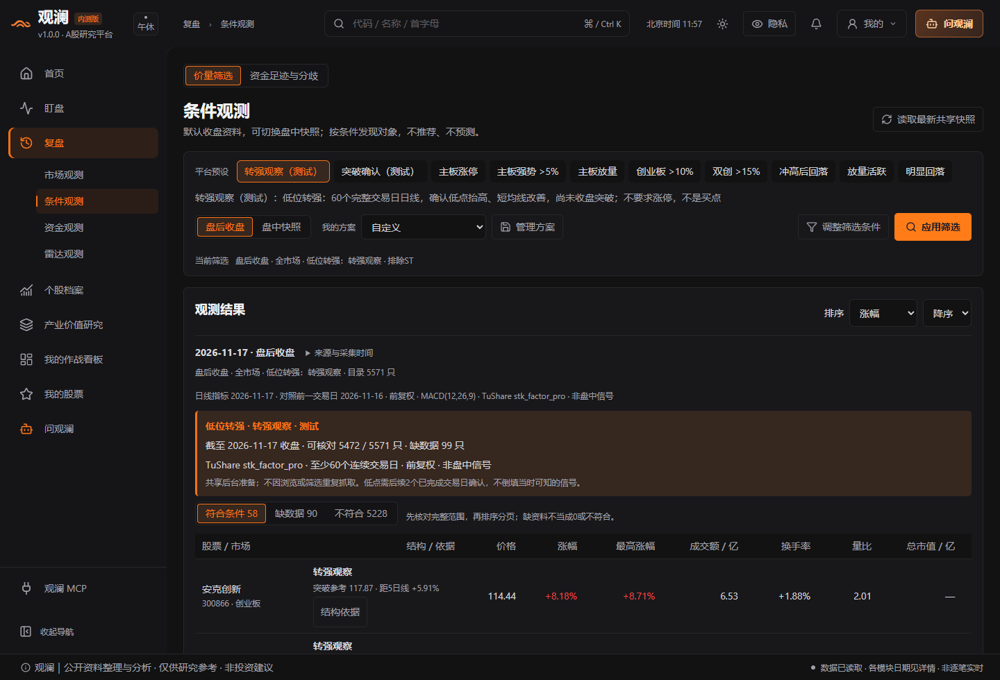
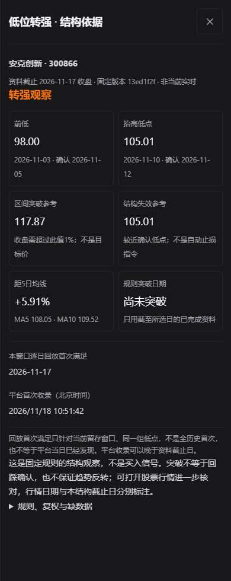

# 低位转强结构筛选（测试）

入口：复盘 → 条件观测 → 价量筛选。平台预设提供“转强观察（测试）”与“突破确认（测试）”，选择预设会切到盘后收盘、全部A股和排除ST；点击“应用筛选”才读取结果。也可在更多条件中选择结构阶段，与价量、行业、概念、均线／MACD条件组合，所有选中条件需同时满足。不要求涨停。

## 两个阶段

| 阶段 | 规则含义 | 不代表什么 |
| --- | --- | --- |
| 转强观察 | 已确认低点抬高，短均线改善，收盘尚未超过区间阻力1% | 不是买点，不保证止跌或反转 |
| 突破确认 | 同一结构最近5个交易日内首次可确认收盘超过阻力1%，且所选日仍在其上 | 不等于突破后的首次缩量回踩或再次转强 |

初版固定规则为 `low-turn-v1`，属于可核对的启发式，而非收益模型。至少需要60个连续、已完成交易日的收盘价／最高价／最低价和复权因子；按所选收盘日因子统一为前复权。

- 最近35个交易日窗口识别已确认低点：低点两侧各需要2个已完成交易日，不能在低点当天借用未来两天确认。
- 两低点间隔至少5个交易日，后低至少抬高1%；前段高点至前低回落至少10%。
- 所选收盘在60日价格区间下方65%内，高于5日和10日均线且5日线向上；不高于前低40%、不高于10日均线18%。
- 两低点之间的最高价为区间阻力参考，较近低点为结构失效参考。参考不是目标价或自动止损指令；不下单，不修改真实持仓。
- 成交量仅辅助核对，不强制放量，不用缺量数据伪造量能。均线／MACD组合使用各自同日已发布指标，另一条件缺数据仍会列明。

## 时间、覆盖与缺数据

结构只读取已经完成且发布的收盘日线，不是盘中信号。共享后台从交易日16:00后尝试补齐，并为17:30、19:30之后保留后续机会，当日上限3次；不能因16:00空数据就提前用完。是否更新仍取决于上游发布和实际采集成功；展示的截止日、批次和来源才是有效口径，不能把计划时间当成数据已到。

“全市场”指该收盘快照的完整A股目录，不是精选池。后台一次准备，全体用户共享；Harness读取同一共享结果，本地不再逐股扫描，也不需要自己的Agent计算。预设的排除ST、市场和行业条件会改变实际结果范围；全目录可计算家数与当前筛选家数分别显示。

历史、复权、日历或同日报价缺失均为未知，不补0、不借旧日指标。新股、停牌缺档等可能不具备连续60个交易日历史。已有明确不符合的其他条件时进入“不符合”，并保留另缺字段；剩余条件可能匹配但缺资料的进入“缺数据”。历史仍在准备时显示已收录批次，不把0个匹配称为全市场没有形态。

名称旁的“结构依据”固定结果版本，可看低点与确认日期、突破／失效参考、距均线以及两个不同日期：

- **本窗口逐日回放首次满足**：在当前可用留存窗口内、按每个当日已完成资料回放的首次满足，不是全历史首次，也不证明平台当日已经发现。
- **平台首次收录**：该低点结构第一次实际写入观澜的时间，以北京时间展示；可能晚于资料截止日，重复扫描不重置。

图表行情与结构截止日可能不同，需各自核对。首版不提供自动买卖、胜率或历史收益承诺；一次反弹不等于趋势反转。

## 数据与运行边界

使用既有TuShare服务端权限，批量复用 [`stk_factor_pro`](https://tushare.pro/document/2?doc_id=328) 的原始日线与复权字段，官方交易日历约束日期。来源授权不因本项目源码可见而自动转授。密钥不进浏览器或公开仓库。

历史批次按日期共享缓存，单轮最多4次新请求；沿用共享请求预算、互斥和失败冷却，不因刷新／分页／打开依据重抓市场。首次准备有界补齐目标窗口，较早批次失败不抹掉已经核验且满足最近60日的同日结果。旧不可变结果模型保留供分页和依据读取；手机只保留表格横滑，纵向跟随页面，结构入口至少44px。

本批不改MCP接口或权限，不修改Agent、账号、自选、持仓、腾讯资金采集器、定时器或OpenClaw。验证和实际发布状态见根目录CHANGELOG；源码预览不是新的安装器。

## 界面示例

截图为2026-11-17收盘批次的功能展示，不会随行情更新，不是投资建议。

