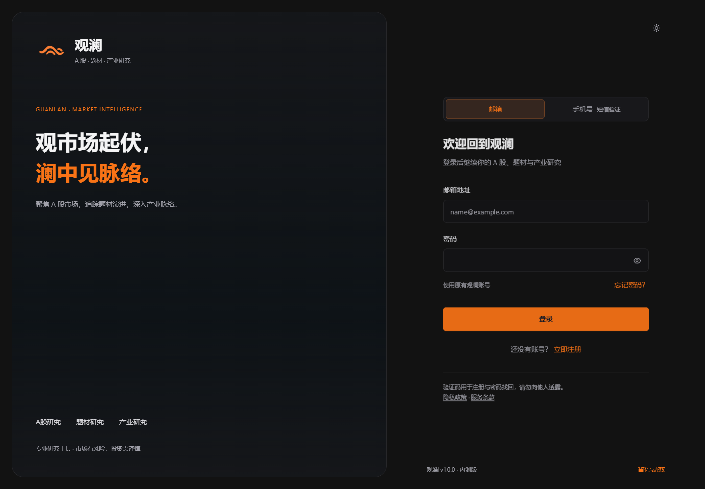

# 本地 Harness 使用指南

[返回项目介绍](../README.md)

## 安装与启动

当前实测环境为 Windows / Node.js 24.15.0；需要 Node.js 24+、npm、Git和观澜账号。个人自用免费，机构业务与商业服务使用前请先取得[商业授权](../COMMERCIAL.md)。

```powershell
git clone https://github.com/joearkon/guanlan-a-stock-research.git
cd guanlan-a-stock-research
npm ci --prefix frontend
npm run build
npm start
```

打开 **http://127.0.0.1:38931/next/**。构建会准备OCR Worker、语言包和许可证，初次安装构建需要网络，不必手工提交生成文件。

## 1. 登录观澜账号

在本地登录页使用自己的观澜邮箱与密码，连接共享资料并隔离保存个人记录。注册、验证码、找回密码和账号安全继续在官网管理。



观澜账号提供共享数据与账号隔离，Agent供方账号提供AI能力，两者独立。自己的观澜权限和共享数据覆盖决定能读取哪些资料。

## 2. 连接自己的AI Agent

先在自己的电脑安装并登录所选CLI，或准备自己的DeepSeek API Key，再打开“问观澜”下方的“本地 AI Agent”或右上角状态灯。

1. 选择一个Agent，只检测这一项；没有选择时不扫描全部CLI。
2. 按提示处理安装、登录或密钥问题。环境检测不运行模型。
3. 核对费用来源，点击“测试并连接”。这一步使用自己的供方额度。
4. 成功后查看“当前已配置”与连接状态；需要更换时点击“更换 AI Agent”。

| 来源 | 配置方式 | 费用与验收范围 |
| --- | --- | --- |
| Codex | 使用自己的账号登录官方CLI | 自己的ChatGPT账号额度；已完成真实联网、保存、重开与防重复执行验收 |
| WorkBuddy / CodeBuddy | 自己的CLI账号，可指定安装位置 | 自己的供方额度；已有真实联网回执，本轮未新增付费重测 |
| Claude Code | 使用自己的账号登录官方CLI | 以检测出的订阅、Console/API等来源为准；接入与离线回归完成，需在自己的环境主动实测 |
| DeepSeek | 在本地配置页填写API Key | 自己的API余额，含可能的联网费用；配置后主动实测，不是网页聊天额度 |

DeepSeek密钥使用Windows CurrentUser DPAPI加密，接口不回显，不上传SaaS；更换或移除后需重新测试。其他系统目前没有明文回退。不要把密钥、登录文件或Token发送到聊天或Git。

更换候选失败不自动替换原配置，不切其他供方或平台扣费。连接状态表示已有验证回执且当前环境就绪，不保证每轮网络、余额或供方服务都可用。

## 3. 发起与保存研究

- **问观澜：** 输入问题，按需选择设置后发送。手机回车换行；电脑Enter发送、Shift+Enter换行。模板只填草稿，不自动运行。
- **AI盘面点评：** 在复盘入口主动发起，使用同一Agent分析已提供的盘面资料。
- **我的研究：** 在“我的股票 → 我的研究”创建公司、产业或专题，确认对象、资料日与重点。AI报告完成后留档；文字笔记不调用AI。

回答保留原生Markdown，默认不套平台JSON，不执行模型HTML。研究依据区仅展示已提供的共享证据，不把模型链接自动当作已核验事实。模型推理与联网通常仍在供方云端完成，本地Harness不是完全离线模型。

浏览、检索、刷新、重开历史和核对回执不新增模型执行。失败或中断时保留原任务编号，先核对，不要连点重新生成；未确认执行不会自动重跑，也不切平台扣费。失败仍可能有供方费用，以自己的账单为准。

## 手机条件观测与列表滚动

条件观测的价量筛选和资金足迹，在手机布局下接近结果底部时追加下一批20条，也可点击“继续加载20条”。表格纵向跟随页面，横向仍可查看后面的字段；超过50条后只渲染可见区域。电脑保留“上一页／下一页”。

“已全部显示 · 4 / 4”表示所选条件真实只有4条，并非只允许显示4条。符合条件、缺数据和不符合分别统计，追加不会放宽条件或补造标的。滚动固定本轮行情／成员／资金版本；应用新条件、切分类或读取最新结果会重新开始。追加失败保留已加载内容且不自动重试，409提示需明确读取最新结果。

异动接力仍使用原有分批追加；自选和持仓属于有限的个人列表，不额外制造无限请求。列表滚到边界后可交回页面滚动；图表与抽屉保留各自的操作边界。异动接力卡片也收紧宽屏角标留白，小屏把统计和状态并排，保留触控空间。

## 盘中异动的行业与板块

实时动态采用紧凑列表，异动的采样窗口涨幅为红色、跌幅为绿色，仍保留正负号与触发依据。行业／板块共用的快照日期、采集时间及“非事件时点”统一放在列表顶部，各条事件自己的触发时间不变。桌面收紧行距；手机保留字号、44px触控和正常换行。热点题材的来源与筛选栏也沿用紧凑排布。

“盯盘 → 盘中异动”在每条事件旁展示共享目录已核验的行业和关联板块；手机放在事件下方。点击名称可查看固定版本的成员与报价，更多关联按目录成员交集和稳定来源顺序选择，不挑涨得最高的概念。

涨幅采用同批有效成分股的中位数（覆盖至少95%），不是板块指数，也不是事件采样窗口涨幅。界面分别标注当前目录归属、采集时间和“非事件时点”；历史日期与快照日期不一致时不倒填数值，归属冲突、缺时间或缺报价保留缺项。目录日期不代表个股归属的历史生效日期。

滚动和分页固定行情／成员版本；需要新数据时点击“更新板块快照”，不会重排原事件。读取失败保留原快照及日期，原触发依据仍可打开。此入口只读共享资料，不调用模型、不修改持仓或自选。

## 停止、更新与端口

- **停止：** 终端按Ctrl+C。进行中任务可能变成停止或待核对，重新启动不自动重跑。
- **再启动：** 有已有构建时，在仓库运行 `npm start`。
- **更新：** 保留自己的修改并停止服务，再依次运行 `git pull --ff-only`、`npm ci --prefix frontend`、`npm run build`、`npm start`。
- **端口占用：** 在当前PowerShell设置 `$env:GUANLAN_LOCAL_PORT="38932"` 后启动，使用相应端口；仍只监听本机回环。
- **重启登录：** 观澜会话只在服务内存保存，重启后重新登录；Agent配置和个人历史不因此清除。

同一数据目录不能启动两个服务，服务锁会阻止第二个实例。

## 数据与安全

资料出处、资金指标和费用边界见[数据来源说明](DATA-SOURCES.md)。外部客户端可用的线上工具与后续补齐顺序见[MCP 能力与路线图](MCP-ROADMAP.md)，不要与本地运行时的本轮证据工具混淆。

```text
.local/
├── research.sqlite   # 账号隔离的资料、配置、任务与回执
└── jobs/             # 本轮公开输入、证据等运行资料
```

- 自选、持仓、方案、研究与笔记保存在本机，不自动同步或覆盖官网个人资料；作战看板布局仅当前浏览器保存。
- 备份前正常关闭服务，再备份整个 `.local`。其中可能含个人研究及加密凭据，不要上传Git、issue或公开日志。
- 自动交给Agent的是明确提问与选定公开资料，不自动发送持仓成本、登录文件或密钥；自行写进提问的内容仍会发送给供方。
- Token、内部调用次数、剩余额度或金额未提供时不补零，CLI启动次数不等于内部模型请求数。
- 本版本不开放交易、下单或任意本机文件读写；本地Skill自动安装和平台专用编排完整迁移尚待单独验收。
- 行情、板块、K线和已发布产业资料读取共享成品，不由本地Agent接管全市场采集、自动研报发布或云端提醒。

## 常见问题

**已有Codex登录，为什么还要登录观澜？**

Codex提供AI，观澜账号提供共享数据和记录隔离，不能互相替代。

**没有行情或显示旧日期？**

先核对账号权限、网络、资料日期及覆盖提示。休市可以阅读历史快照，不将旧数据改成今天，也不让AI补造行情。

**手机可以调用电脑或安卓里的WorkBuddy吗？**

目前不提供跨设备连接。移动布局适配不等于支持手机Agent或远程调用；服务默认只在127.0.0.1开放。

**怎样诊断CLI环境？**

可主动运行 `npm run doctor`，只读扫描支持的CLI、不调用模型。这是手工诊断，与首次配置页不自动扫描的行为不同。

**在线版和本地版有何区别？**

在线版正在试运营，用浏览器访问并由平台提供AI。Harness使用自己的AI，个人记录保存在本机；账号安全、提醒及通知仍去官网管理。两版个人数据库不自动互相覆盖。

## 开发与验收

```powershell
npm test
npm --prefix frontend test
npm run build
```

真实供方验收会产生自己的费用，不能作为普通测试自动运行。完整范围见[QA记录](../QA.md)，不得用夹具冒充真实登录、全部市场数据、其他引擎或操作系统已通过。

```text
frontend/   React界面与主题
src/        本地服务、任务、供方连接器和数据读取白名单
shared/     产业目录与数据合同
vendor/     保留许可的第三方CLI适配
web/        展示模型、品牌和题材资源
scripts/    构建、诊断与手工验收入口
test/       后端回归
docs/       使用指南与配图
```

UI起始基线为已核验的SaaS `2026.11.13.7`，本地独立迭代，不自动随SaaS发布替换代码。见[溯源](../baseline/production.json)。

项目采用[个人使用与商业授权许可证](../LICENSE)：个人自用（含自己的投资研究）、学习和修改免费，机构业务及对外商用需授权。属于源码开放，不是OSI标准开源许可；第三方依赖保留各自许可，见[第三方清单](../THIRD_PARTY_NOTICES.md)与[NOTICE](../NOTICE.md)。配图是公开历史资料或隔离演示，不含真实私人研究，不是全部功能已验收的证明。
